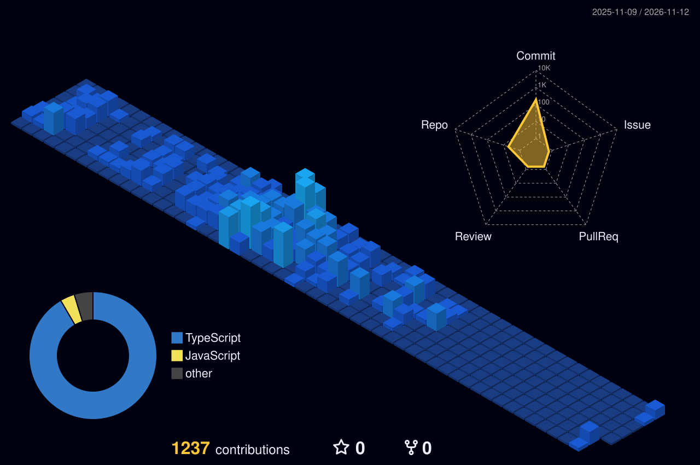

 

 

 

## 〈 About Me 〉

### Hi there, I'm Tanjil 👋

I'm a **Full Stack Engineer** from **Sylhet, Bangladesh 🇧🇩**, with **2+ years of experience at Technext Limited** (May 2024 – Jul 2026), building enterprise-scale platforms for clients across the USA & Europe.

I've shipped features on **[Greysheet](https://greysheet.com)** — a 12M+ record numismatic data platform trusted since 1963 — and **[OneSuite](https://onesuite.io)**, a business communication SaaS. Outside of work, I ship personal products and grind competitive programming.

**🏢 Delivered @ Technext Limited**
- `OneSuite` — Technext's own SaaS product · marketing website (Astro · i18n)
- `Greysheet` — USA-based numismatic pricing platform (UI · Razor · .NET)
- `Bmboo Lighting` — Shopify storefront for client (New Mexico, USA)
- `DermaQuestInc` — Shopify e-commerce for client (California, USA)

**🛠️ Personal projects shipped**
- `Sunnah Cure` — healthcare appointment booking platform
- `MoneyPilot` — personal finance dashboard
- `Pharma Nest BD` — online pharmacy system
- `Uni Cover Page Generator` — academic utility tool

**📚 Currently learning** — System Design · Cloud Architecture

**📄 Research** — 2× IEEE Xplore published · Blockchain & Distributed Systems

**🎓 Education** — B.Sc CSE @ SEC · CGPA **3.80 / 4.00**

**⚡ Fun fact** — I debug at 2am... and it actually works 🌙

 

## 〈 Tech Arsenal 〉

**Languages & Frontend** 

  

**Backend & Database** 

  

**DevOps & Tools** 

  

## 〈 Experience 〉

<table>
<tr>
<td align="center" width="18%" valign="top">
 

**May 2024 — Jul 2026**

*2+ Years*

</td>
<td width="82%" valign="top">

### Technext Limited — Junior Software Engineer

*Intern Software Engineer (May 2024 – Jul 2024) → Junior Software Engineer (Aug 2024 – Jul 2026)*

Delivered **4 production projects** for clients across the USA & Europe — spanning enterprise platforms, SaaS websites, and Shopify storefronts.

- 📊 Built & maintained frontend UI for **[Greysheet.com](https://greysheet.com)** — industry-standard numismatic pricing platform trusted since **1963**, serving dealers & financial institutions globally
- 🚀 Developed the full marketing website for **[OneSuite.io](https://onesuite.io)** from scratch — multi-page, SEO-friendly, with **i18n (English & German)**
- 🪔 Built a custom Shopify storefront for **[Bmboo Lighting](https://bmboo-lighting.com/)** (New Mexico, USA) — sustainable home decor brand, mobile-first with brand-aligned checkout flow
- 💄 Delivered pixel-perfect Shopify theme for **[DermaQuestInc](https://dermaquestinc.com/)** (California, USA) — professional skincare brand with international checkout & payment methods

`ASP.NET Razor` `.NET` `Astro` `TypeScript` `Tailwind CSS` `Shopify` `Liquid` `JavaScript` `Bootstrap`

</td>
</tr>
</table>

## 〈 Projects 〉

### ── Professional @ Technext Limited ──

<table>
<tr>
<td width="50%" valign="top">

#### 💬 [Greysheet](https://greysheet.com) — Numismatic Pricing Platform
> Client Project · USA · Production

Industry-standard coin & currency pricing platform trusted by dealers and financial institutions since **1963**. Built and maintained frontend UI for real-time wholesale and retail price guides covering antique coins, modern collectibles, and currency — serving a global numismatic audience.

**Contributions**
- 🖥️ Responsive UI development with Razor templates
- 📈 Price guide & auction data display optimization
- ✅ Cross-browser compatible, production-ready feature delivery

`ASP.NET Razor` `.NET` `JavaScript` `Bootstrap` `CSS`

</td>
<td width="50%" valign="top">

#### 🚀 [OneSuite](https://onesuite.io) — SaaS Landing Website
> Technext Own Product · Production

Next-gen client portal platform for agencies and freelancers. Built the full marketing website from scratch, delivering a high-converting, performant landing experience.

**Contributions**
- 🏗️ Full website development from provided designs
- 📄 Multi-page architecture — features, use-cases & pricing
- ⚡ Performance-optimized, SEO-friendly static site build
- 🌍 i18n implementation — English & German

`Astro` `TypeScript` `Tailwind CSS`

</td>
</tr>
<tr>
<td width="50%" valign="top">

#### 🪔 [Bmboo Lighting](https://bmboo-lighting.com/) — Sustainable Home Decor
> Client Project · New Mexico, USA · Production

Sustainable bamboo lighting brand based in **New Mexico, USA**. Built a brand-aligned Shopify storefront from scratch — replacing a scattered sales process with a clean, nature-inspired shopping experience.

**Contributions**
- 🎨 Custom Shopify theme development from provided designs
- 📱 Mobile-first responsive layout & page speed optimization
- 🛍️ Product page structure with clear layout & image support
- 🛒 Consistent checkout flow aligned with brand aesthetics

`Shopify` `Liquid` `JavaScript` `CSS`

</td>
<td width="50%" valign="top">

#### 💄 [DermaQuestInc](https://dermaquestinc.com/) — Skincare E-Commerce
> Client Project · California, USA · Production

Professional skincare brand with **20+ years** of industry expertise based in **California, USA**. Converted a pixel-perfect design into a fully functional Shopify storefront with international sales capabilities.

**Contributions**
- 🎯 Pixel-perfect Shopify theme from provided designs
- 🌐 International checkout with multiple payment methods
- 📱 Responsive, mobile-first storefront with optimized load time
- 🔍 SEO best practices & scalable architecture

`Shopify` `Liquid` `JavaScript` `CSS`

</td>
</tr>
</table>

### ── Personal ──

<table>
<tr>
<td width="50%" valign="top">

#### 🩺 [Sunnah Cure](https://sunnah-cure.vercel.app/) — Healthcare Booking Platform
> Personal Project · Full Stack

A holistic **diagnostic center appointment booking** platform combining Prophetic medicine with modern healthcare. Supports online/offline services with full booking, dashboard & multilingual support.

**Highlights**
- 🔐 Auth — register · login · role-based dashboard
- 📅 Full appointment booking & scheduling system
- 🌐 Bilingual — English & Bengali (বাংলা)
- 📊 Patient dashboard with follow-up tracking
- ⭐ 500+ patients served · 98% satisfaction

`Next.js` `TypeScript` `TailwindCSS` `PostgreSQL` `Prisma`

</td>
<td width="50%" valign="top">

#### 💰 [MoneyPilot](https://money-pilot-orcin.vercel.app/) — Finance Dashboard
> Personal Project · Full Stack

Smart **personal finance dashboard** — take full control of your money by tracking income, expenses, budgets and financial goals with a clean, intuitive interface.

**Highlights**
- 🔐 Secure auth — sign up · sign in · password reset
- 📊 Finance tracking & insights dashboard
- 💸 Budget management & goal tracking
- 📱 Fully responsive modern UI

`Next.js` `TypeScript` `TailwindCSS` `PostgreSQL`

</td>
</tr>
<tr>
<td width="50%" valign="top">

#### 🏥 [Pharma Nest BD](https://pharma-nest-bd.vercel.app/) — Online Pharmacy
> Personal Project · Full Stack

A full-featured **online pharmacy platform** with product listings, smart search, cart management, and a complete order management system.

**Highlights**
- 🔍 Smart product search & filtering
- 🛒 Cart & order management system
- 💊 Full pharmacy catalog & product pages
- 📱 Fully responsive modern UI

`Next.js` `TypeScript` `TailwindCSS` `PostgreSQL`

</td>
<td width="50%" valign="top">

#### 📄 [Uni Cover Page Generator](https://cover-page-generator-blush.vercel.app/) — Utility Tool
> Personal Project · Frontend

Auto-generate formatted **university assignment cover pages** in seconds — fill in your details and instantly download a perfectly formatted document. Saves students hours every semester.

**Highlights**
- 📝 Instant cover page generation
- 🎓 University-standard formatting
- ⬇️ One-click download
- 📱 Fully responsive, works on any device

`Next.js` `TypeScript` `TailwindCSS`

</td>
</tr>
</table>

## 〈 GitHub Analytics 〉

  

## 〈 Competitive Programming 〉

| Platform | Handle | Solved | Rating | Rank |
|:--------:|:------:|:------:|:------:|:----:|
| **Codeforces** | [tanjil-ahmed](https://codeforces.com/profile/tanjil-ahmed) | **1850+** | 🟡 **1678** | Expert |
| **CodeChef** | [tanjilvai](https://www.codechef.com/users/tanjilvai) | **100+** | 🟢 **1731** | ⭐⭐⭐ |
| **UVa OJ** | TanjilAhmed | **50+** | — | Active |
| **LightOJ** | ahmedtanjil1 | **70+** | — | Active |

## 〈 Achievements 〉

| 🏅 | Achievement | Event | Year |
|:---:|:---|:---|:---:|
| 🥇 | **Qualified** | ICPC Dhaka Regional | 2023 |
| 🥇 | **Qualified** | NCPC @ Jahangirnagar University | 2023 |
| 🥈 | **Runners Up** | SEC Idea Hackathon | 2022 |
| 🥉 | **2nd Runners Up** | CSE DAY Programming Contest | 2020 |
| 👑 | **Vice President** | SEC CSE Society & SEC Programming Club | 2023 |
| ⚖️ | **Problem Setter & Judge** | CSE Day, SEC | 2024 | 

## 〈 IEEE Research 〉

> 🔬 **Blockchain & Distributed Systems — IEEE Xplore 2024**

<table>
<tr>
<td>

📄 **S-DrivingRecords** — Blockchain Based Enhancing Trust and Transparency in Driving Records Using Hyperledger Fabric

</td>
</tr>
<tr>
<td>

📄 **SafetyNet** — A Decentralized Police Complaint Management System for Bangladesh Using Blockchain Technology

</td>
</tr>
</table>

### *"Code is like humor. When you have to explain it, it's bad."*
**— Cory House**

 

**Drop a ⭐ on anything you find useful**

 

